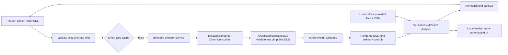

# Threadglass

**Room for the conversation.** An open-source, browser-powered reader for public Reddit threads.

Paste a thread or subreddit URL. Threadglass opens the actual webpage in standard Playwright Chromium, extracts the content rendered in that signed-out browser, and presents it in a quieter, mobile-first reader. No Reddit API credentials, OAuth, or Threadglass account.

> **Early alpha.** An approved Browser Use managed-cloud test retrieved a real ELI5 title and **25 comments**, then presented the captured snapshot in the reader. Standard local Chromium was blocked from the initial host. The full live compatibility matrix and a production cloud backend remain incomplete; see [the dated compatibility report](docs/compatibility.md).

## Try it with Docker

```sh
git clone https://github.com/icarus-online/threadglass.git
cd threadglass
docker compose up --build
```

Open **http://localhost:3001**. Paste a URL such as:

```text
https://www.reddit.com/r/explainlikeimfive/comments/208ft5/eli5why_is_earths_core_molten_what_keeps_it_warm/
```

The container runs as `pwuser`, keeps Chromium's sandbox enabled, uses Playwright's seccomp profile, and publishes only to loopback. Hosts must permit user namespaces for Chromium sandboxing. A source block is a legitimate result; Threadglass does not work around it. The image and npm Playwright versions are pinned together.

## What is included

- Reusable real Chromium with independent, signed-out contexts for each request.
- Two simultaneous reads, a 35-second total request budget, cancellation, cleanup, and replacement after a browser disconnect. Excess work receives a bounded `429 busy` response instead of an unbounded queue.
- A versioned DOM adapter for modern `shreddit-*` and legacy Reddit markup, including open shadow DOM. Comment parent relationships, deleted-author markers, timestamps, displayed scores, rich text, tables, code, and available media stay attached to their source.
- Targeted dismissal of app-promotion controls and bounded comment expansion/scrolling. No blind clicking, authentication, voting, posting, CAPTCHA solving, or stealth behavior.
- Dark mode, collapsible replies, search within loaded comments, top-level comment navigation, spoiler disclosures, media viewing, and device-local bookmarks.
- A local userscript sharing the schema, adapter, and React reader. It reads already-loaded DOM without sending discussion content to a backend.
- Source availability reporting, optional diagnostics, URL/DNS/redirect restrictions, HTML sanitization, rate limits, a small short-lived cache, Docker Compose, CI, and tests.

## Local development

Use Node **22.12+** and a host with the Playwright Chromium dependencies installed:

```sh
npm ci
npx playwright install --with-deps chromium
npm run dev
```

Open http://localhost:5173. For a production build:

```sh
npm run build
npm start
```

The production server defaults to `127.0.0.1:3001`. It serves the Vite build and JSON API from the same origin. `HOST` and `PORT` configure the listener. Environment variables must be injected by the operator; no environment-file loader is installed. No credentials are required for local Chromium.

## Optional local reader

Install a userscript manager, then open `/threadglass.user.js` on your own running Threadglass instance and install the script. A **Read with Threadglass** button appears on supported Reddit pages. Open a public thread normally first, load the replies you want, then activate the button.

The reader mounts above the original page in a shadow root; **Return to Reddit** restores it. It extracts only the content already loaded at activation time. Continuation links navigate through your own browser and need activation again. The script performs no remote extraction. Media and user-clicked links may still contact their original hosts. Userscript-manager support and page content policies vary, particularly on Android; a compatible manager is required. The local reader has fixture-based browser tests; live Reddit validation is pending.

## How it works



The worker does not call Reddit's JSON endpoints, request API credentials, copy a user's cookies, or reconstruct comments from search engines. Source blocks, explicit authentication requirements, rate limits, promotions, rendering failures, and partial snapshots are distinct outcomes. A promotion alone is never treated as proof that login is required. Content already rendered beneath a promotion can be extracted.

`POST /api/read` accepts:

```json
{ "url": "https://www.reddit.com/r/explainlikeimfive/", "viewport": "mobile" }
```

It returns a versioned `Discussion` defined in [shared/schema.ts](shared/schema.ts). Source outcomes return structured data with an availability status, even when no content was retrieved. Invalid requests, busy workers, cancellation, and worker failures use structured HTTP errors. `GET /api/health` checks the HTTP service, not Reddit availability.

## Tests and live evidence

```sh
npm run check            # unit tests, TypeScript, production build and userscript
npm run test:e2e         # Chromium fixture tests: desktop and Android-size viewport
npm run licenses        # locked dependency license inventory
DIAGNOSTICS=true npm run test:live
```

`test:live` visits all ten scenarios in [scripts/live.ts](scripts/live.ts), captures normalized output, and records whether each scenario's actual content assertions passed. It exits `2` if any scenario is unverified. A block does **not** count as passing a content-retrieval assertion. Deleted-author, promotion, and login URLs are explicitly candidates until actual DOM evidence confirms the requested state.

Diagnostics save screenshots, DOM snapshots, and extraction data under ignored `artifacts/`. They are private operator evidence, are never served by the app, and must not be committed. See [architecture](docs/architecture.md), [security](SECURITY.md), [self-hosting](docs/self-hosting.md), and [limitations](docs/limitations.md).

## Remote/cloud Chromium

A standard Chromium CDP endpoint can be configured with `CHROMIUM_CDP_URL` and `REMOTE_EGRESS_PROXY`. Both are required: interception alone is insufficient to enforce remote network destinations. The remote proxy must enforce the same allowlist, public-IP validation, and DNS pinning. Use fresh contexts with no profiles or saved sessions. Protect the CDP endpoint and never expose it publicly. This remote path is implemented but not integration-tested.

Browser Use's GitHub OAuth connection was verified separately during setup. It is not needed by the default reader. Browser Use was tested as a separate operator-only cloud experiment after the owner authorized its built-in browser behavior and standard US proxy route. The direct connection returned HTTP 403; the proxy route returned a verification challenge. An explicitly approved two-page test with provider CAPTCHA handling then retrieved the ELI5 title and 25 comments; the listing was rate-limited. All sessions were stopped. See the compatibility report and `scripts/cloud-live.ts`. This CLI is not yet an anonymous production backend: provider-side network isolation remains a separate requirement. Do not place any cloud key in the repository or frontend.

## Contributing

Read [CONTRIBUTING.md](CONTRIBUTING.md). Improvements need DOM regression fixtures and honest live evidence when claiming compatibility. Keep the signed-out browser boundary intact. Threadglass is independent and not affiliated with Reddit.

## License

[MIT](LICENSE) for Threadglass code. Dependencies, Chromium, bundled fonts, and source-site content retain their own licenses and rights; see [THIRD_PARTY_NOTICES.md](THIRD_PARTY_NOTICES.md). Threadglass's license does not relicense Reddit discussions or grant access to restricted content.
